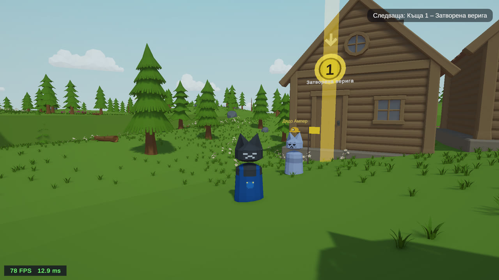
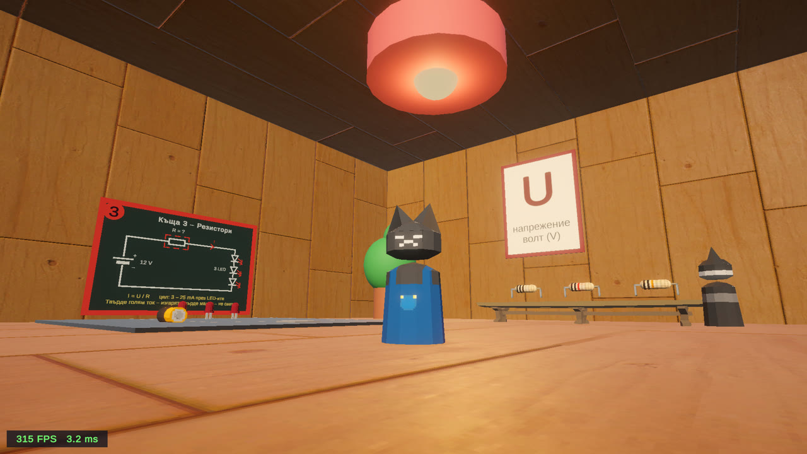
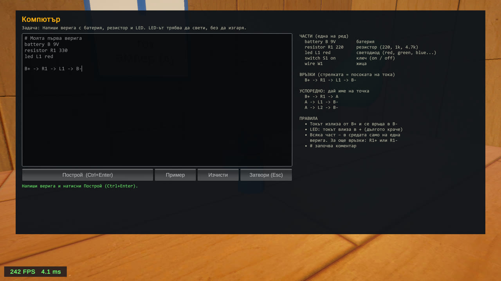

# CatCircuit (Котаракът електротехник)

CatCircuit is a 3D Unity game that teaches 8th-grade students how simple electric circuits work: batteries,
resistors, LEDs, switches, series and parallel connections, and Ohm's law. It is part of a diploma thesis.
You play a cat in a village of cats and help the neighbours by placing oversized parts into breadboard slots.
The highlight is **House 5**, where the player *writes* a circuit in a small language (CircuitScript) and the
code is turned into a live 3D circuit on the floor, with glowing wires and LEDs driven by a real simulator.

The game is in Bulgarian.

## Video

[](https://youtu.be/FGRVMovFv8E)

▶ **[Watch the gameplay video on YouTube](https://youtu.be/FGRVMovFv8E)**

## Screenshots

| The village (hub) | House 3: Ohm's law | House 5: CircuitScript terminal |
|---|---|---|
|  |  |  |

## Features

- **Five houses, five lessons**
  | House | NPC | What it teaches |
  |---|---|---|
  | 1 | Professor Whiskers | A circuit must be **closed**: put the battery and the resistor in place so the LED lights. |
  | 2 | Ms. Purrington | **LED polarity**: the LED only lights when it is turned the right way (R rotates it). |
  | 3 | Old Tom | **Ohm's law**: pick the resistor that keeps three LEDs between 3 and 25 mA (100 Ω burns them, 10 kΩ is too dark). |
  | 4 | The Kittens | **Series vs. parallel**: LEDs in series share the current and are equally dim, LEDs in parallel are bright. |
  | 5 | Mayor Fluffington | **Code puzzle**: write the circuit in CircuitScript; light an LED, light two LEDs from a ≤3 V battery (forces parallel), add a master switch. |
- **A real circuit simulator**: nodal analysis with piecewise LED models (red, green, blue forward voltages,
  20 mA full brightness, over 30 mA the LED burns). It detects short circuits, reversed LEDs and burning LEDs, and
  every puzzle is just a set of conditions on its results.
- **CircuitScript**: a tiny circuit language with English *and* Bulgarian keywords
  (`battery/батерия`, `resistor/резистор`, `led/лед`, `switch/ключ`, `wire/жица`), and errors in Bulgarian with line numbers.
  The code terminal also shows a "multimeter" read-out (current through each LED and resistor).
- **Save / continue**: solved puzzles are saved (PlayerPrefs, also works in the browser).
- **Title menu**: Продължи (n/5), Нова игра, Управление, Настройки, Кредити; pause menu on Esc.
- **House 1 tutorial**: short first-time tips that advance when the player actually does each step (Tab skips).
- **Teacher unlock**: press **F9** on the title menu and enter the teacher code to jump straight to any house.
- **Anonymous telemetry** (for the thesis evaluation): stages, hints, short circuits, code builds… No names and nothing
  the player typed. It is **off / console-only until a form URL is configured** (`TelemetryConfig` in
  `Assets/_Game/Scripts/Core/Telemetry.cs`), and players can turn it off in Настройки.
- All sound effects are synthesized in code; menus are drawn with IMGUI, so they need no scene setup.

## Controls

| Key | Action |
|---|---|
| W A S D | move |
| Space | jump |
| E | pick up / place / talk / enter |
| R | rotate the part |
| Q | drop what you are carrying |
| Esc | pause menu |
| Ctrl+Enter | build the circuit (House 5 code terminal) |
| F3 | show / hide FPS |
| F9 | teacher code box (title menu only) |

## Getting started

1. Install **Unity 6000.4.11f1** (Unity 6) with **Web Build Support** and/or **Windows Build Support**.
   The project uses URP, the New Input System, Cinemachine 3 and TextMeshPro.
2. Clone the repository and open the folder in Unity Hub (the first import takes a while).
3. Open `Assets/_Game/Scenes/Outside.unity` (the village, first scene in the build list) and press Play.
   The title menu appears; untick **CatCircuit ▸ Show main menu in Play Mode** to skip it while testing.

Useful editor menus: **CatCircuit ▸ Reset saved progress**, **CatCircuit ▸ Reset tutorial and first-start hints**,
**CatCircuit ▸ Validate open scene**.

## Building

- **CatCircuit ▸ Build ▸ Prepare project for building** (once): shader keep-materials, scene-list check, web settings.
- **CatCircuit ▸ Build ▸ Build Windows (.exe)** → `Builds/Windows/`
- Web:
  1. **CatCircuit ▸ Build ▸ Web size report**: lists the biggest assets the scenes use → `Assets/_Game/CatCircuit_WebReport.txt`.
  2. **CatCircuit ▸ Build ▸ Apply web optimizations**: WebGL-only texture limits + crunch, mesh compression, code stripping (asks first).
  3. **CatCircuit ▸ Build ▸ Build Web** → `Builds/Web/` (upload the contents, e.g. to itch.io).

The web build needs a Cyrillic font at `Assets/_Game/Resources/CatCircuitUIFont.ttf` (browsers have no OS fonts).

## Project layout

```
Assets/_Game/
  Scenes/        Outside (village, index 0), House1 … House5
  Scripts/
    Core/        GameProgress + GameSave, PauseMenu (title + pause), UIManager/GameUI, UIText (all short UI strings),
                 GameAudio (synthesized SFX), GameSettings, Telemetry, Tutorial, ControlsHint, FpsCounter, EndGameScreen
    Player/      Player, PlayerCarry (the cat's mouth), PlayerInteractor (E/R/Q), spawner
    Interaction/ CatInteractable (base of everything you press E on), PickupableItem, SceneTransition (doors)
    Circuit/     CircuitScript (language), CircuitSolver (nodal analysis), CircuitHost, ComponentData, LEDLight
    Breadboard/  Breadboard, BreadboardSlot
    Puzzles/     CircuitPuzzle, CircuitConditions (stages, conditions, hints)
    NPC/         CatNPC (quest flow)
    CodeCircuit/ CodeTerminal, CodeCircuitBuilder (code → 3D circuit), CircuitSwitch
    Editor/      build + web tools, create menus, validator, inspectors, recipes (every house's circuit and stages)
  prefabs/       parts, boards, characters, environment
  README_CatCircuit.md   programmer guide (how to make a new puzzle, part or condition)
```

## CircuitScript example

```
# a battery, a resistor and a red LED in a loop
battery B 9V
resistor R1 330
led L1 red
B+ -> R1 -> L1 -> B-
```

```
# two LEDs in parallel: A is a junction
battery B 9V
resistor R1 220
led L1 red
led L2 red
B+ -> R1 -> A
A -> L1 -> B-
A -> L2 -> B-
```

Arrows follow the current: it leaves the battery at `+` and enters an LED at its `+` (anode). A part can be in the
middle of only one chain; use `R1+` / `R1-` for extra connections. 9 V + 330 Ω + red LED ≈ 21 mA (full brightness).

## Third-party assets and credits

The game uses these third-party packs (most from the Unity Asset Store), each under its own license:

| Folder in `Assets/` | What it is |
|---|---|
| `BrokenVector/` | Low Poly Dungeon (furniture, doors, tiles) |
| `Farland Skies/` | Low Poly skyboxes |
| `PolyRonin/` | Pine Forest Pack, Wooden House in the Snow |
| `YughuesFreeFlooringMaterials/` | Yughues free flooring materials |
| `Stylized Wood Textures/` | stylized wood textures |
| `Hand Painted Seamless Wood Texture/` | hand-painted wood textures |
| `LowlyPoly/` | stylized wood texture |
| `TextMesh Pro/` | Unity TextMeshPro resources (LiberationSans font) |

Made with Unity.

## Author

[antonkalitsov](https://github.com/antonkalitsov), diploma thesis project.
